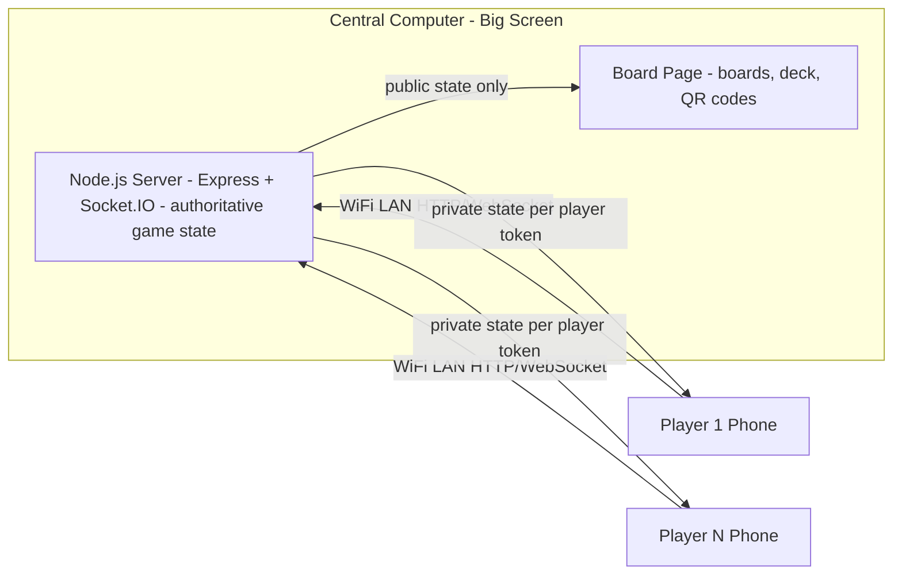

# Secret Hitler Web App — Architecture & Implementation Plan

Digital replacement for the physical Secret Hitler board game (CC BY-NC-SA 4.0 — attribution, non-commercial, share-alike credits included in-app and link to secrethitler.com).

## System Overview



- **Single game instance**, single server on the LAN, port 3000.
- **Server is authoritative**: all deck shuffling, roles, hands, votes validated server-side. Private data is only ever sent to the owning player's socket (identified by a session token in localStorage).
- **Board page** (`/board`): public info only. **Phone page** (`/play`): personal info after joining.

## Rules Reference (verified against the free official PDF)

- 5–10 players. Roles: 5–6 → 1 Fascist + Hitler; 7–8 → 2 + Hitler; 9–10 → 3 + Hitler.
- Deck: 6 Liberal / 11 Fascist tiles. Reshuffle draw+discard automatically when draw pile < 3 (never reveal unused tiles).
- Election: president nominates eligible chancellor (term limits: last elected P & C ineligible; with ≤5 players only last C ineligible). Tie or majority-no → election tracker +1. Tracker hits 3 → chaos: top policy auto-enacted, power ignored, tracker and term limits reset.
- Legislative session: P draws 3, discards 1, passes 2, C discards 1, enacts 1.
- Fascist board powers by player count:
  - 5–6: 3=Policy Peek, 4=Execution, 5=Execution (Veto unlocks at 5)
  - 7–8: 2=Investigate, 3=Special Election, 4=Execution, 5=Execution (Veto at 5)
  - 9–10: 1=Investigate, 2=Investigate, 3=Special Election, 4=Execution, 5=Execution (Veto at 5)
- Veto (after 5 fascist policies): C may request veto; if P agrees, all 3 discarded, election tracker +1, presidency passes on.
- Powers: Investigate Loyalty (party membership only, no player twice per game), Call Special Election (rotation resumes after special president), Policy Peek (top 3, order preserved), Execution (executed players can't speak/vote/run; Hitler executed → Liberals win).
- Win: Liberals = 5 liberal policies or Hitler executed. Fascists = 6 fascist policies or Hitler elected Chancellor after ≥3 fascist policies (with 5-6 players, Hitler knows fascists; 7-10 Hitler doesn't know fascists, fascists know Hitler).
- Role reveal phase: fascists see each other (and Hitler in 5-6); Hitler sees fascists only in 5-6 player games.

## QR Code Flows (jsQR on phones, qrcode lib for rendering)

1. **Join**: Board lobby shows QR of `http://<LAN-IP>:3000/play?g=<gameId>` → phone opens, enters name → appears on board.
2. **Draw 3**: During legislative session the board's virtual deck displays a QR (one-time, president-session-bound token). President scans → the 3 drawn cards appear on *their phone only*.
3. **Pass 2**: President discards 1 on phone → phone shows QR of a one-time transfer token → Chancellor scans → receives 2 cards on their phone → discards 1 → enacts the last.
4. Investigation results, policy peek, role reveal: shown directly on the entitled player's phone (no QR needed).

## Game State Machine (server)

LOBBY → ROLE_REVEAL → NOMINATION → VOTE → (elected? LEGISLATIVE_PRESIDENT → LEGISLATIVE_CHANCELLOR → [VETO?]) → ENACT → (power? EXEC_ACTION) → NOMINATION … with win checks after every policy election/enactment/execution.

## Central Board UI

- Liberal track (5 slots) + Fascist track (6 slots, powers marked per player count), election tracker (3 slots), draw pile & discard pile with **live card counts**, reshuffle indicator.
- Player seating ring: names, president plaque (draggable/manually assignable), chancellor plaque, term-limit markers, executed markers.
- Start-game control; manual president plaque placement; join QR; vote status (who has voted → reveal: per-player Ja/Nein + tally); public event log; license credit.

## Phone UI

- Join/name entry → role card + party membership card (private tap-to-reveal).
- Vote screen (Ja!/Nein). Chancellor nomination picker (president only). Legislative card screens. Veto request/agree screens. Power screens (investigate target picker, special election picker, peek display, execution picker). Claiming-free, no chat needed.

## Launcher Script

`start.sh`: detect LAN IP → start server → `xdg-open http://localhost:3000/board` → print phone join URL + QR to terminal as fallback.

## Testing Strategy (full gameplay coverage)

1. **Unit tests** (node:test): deck/reshuffle logic, role distribution for all player counts, term-limit eligibility, board powers per count, all win conditions, veto, chaos election, investigation-once.
2. **Bot integration tests** (socket.io-client bots): N bot phones + board connect and play *complete random games* at every player count 5–10; assert every phase is reachable and games terminate only via legal win conditions. Scripted scenario tests force: veto path, execution of Hitler, Hitler-chancellor win, special election rotation, chaos reshuffle, deck reshuffle mid-session.
3. **Scripted end-to-end happy path**: deterministic seed driving a full 5-player game with step assertions.

## Repo Layout

```
server/ (app.js, game engine, socket handlers, routes)
public/board/  public/play/  public/shared/
scripts/start.sh  scripts/run-bot-game.js
tests/ (unit + bots)
```

## Implementation Steps (delegated to Orchestrator → CMM-Code)

1. Scaffold Node project, Express + Socket.IO server, LAN IP detection, start.sh launcher.
2. Game engine: state machine, deck, roles, elections, legislative session, powers, veto, win conditions (pure logic, unit-testable).
3. Board UI (boards, piles/counts, plaques, manual president placement, start control, QR).
4. Phone client (join, role, voting, QR draw/transfer, powers) + QR token security.
5. Unit tests + bot full-game test harness + scripted scenarios.
6. README (setup, license attribution).
